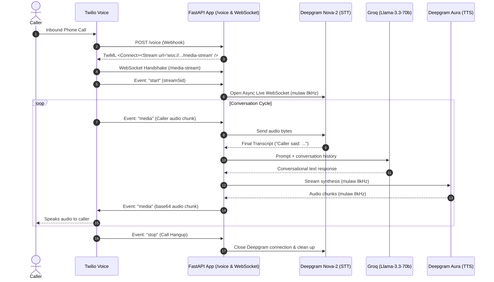

# AI Voice Receptionist

An ultra-low latency, real-time conversational AI voice receptionist designed for small businesses. Built with **FastAPI**, **Twilio Voice Media Streams**, **Deepgram** (Speech-to-Text & Text-to-Speech), and **Groq** (Llama 3.3 70B).

The system handles inbound telephone calls, transcribes caller speech in real time, generates natural conversational responses via an LLM, and streams synthesized voice audio directly back through the phone line without audible delay.

---

## Architecture & Call Flow



### Zero-Transcoding Audio Pipeline
Telephony networks via Twilio use 8kHz `audio/x-mulaw` encoding. This service requests **native `mulaw` at 8000 Hz** directly from both:
- **Deepgram STT (Nova-2)** for streaming speech recognition.
- **Deepgram TTS (Aura)** for streaming speech synthesis.

Because the incoming and outgoing formats natively match Twilio's protocol, no CPU-intensive audio resampling or FFmpeg transcoding is required, keeping latency at a minimum.

---

## Features

- **Bidirectional Telephony Streaming**: Connects directly to Twilio Media Streams using WebSockets.
- **Real-Time Speech-to-Text**: Powered by Deepgram Nova-2 for fast and accurate live transcriptions with interim and final utterance detection.
- **High-Speed Conversational LLM**: Powered by Groq running `llama-3.3-70b-versatile`, delivering responses tailored for natural spoken conversation.
- **Streaming Text-to-Speech**: Deepgram Aura (`aura-asteria-en`) streams audio in chunks back to the caller while the text is being processed.
- **In-Memory Session Management**: Maintains turn-by-turn conversation context for each active phone call session.
- **Configuration Management**: Strictly validated settings with `pydantic-settings` and `.env` support.

---

## Project Structure

```text
voice-receptionist/
├── app/
│   ├── __init__.py
│   ├── call_session.py    # Manages call lifecycle, WebSocket events, and audio piping
│   ├── config.py          # Environment settings with Pydantic BaseSettings
│   ├── llm.py             # Groq LLM integration and system prompt
│   ├── main.py            # FastAPI web server, health check, and Twilio endpoints
│   └── tts.py             # Deepgram Aura streaming TTS client
├── .env                   # Local secrets & API keys (ignored by git)
├── .env.example           # Template for environment variables
├── .gitignore             # Comprehensive rules ignoring secrets, logs, audio & caches
├── requirements.txt       # Project dependencies
└── README.md              # Project documentation
```

---

## Prerequisites

Before running the application, make sure you have:

1. **Python 3.10+** installed.
2. A **[Twilio Account](https://www.twilio.com)** with a voice-capable phone number.
3. A **[Deepgram API Key](https://console.deepgram.com)** (used for both STT and TTS).
4. A **[Groq API Key](https://console.groq.com)** (used for Llama 3.3 inference).
5. **[ngrok](https://ngrok.com)** or a similar tunneling tool (for local development).

---

## Installation & Setup

### 1. Clone the Repository

```bash
git clone <repository-url>
cd voice-receptionist
```

### 2. Set Up a Virtual Environment

**On Windows (PowerShell):**
```powershell
python -m venv venv
.\venv\Scripts\Activate.ps1
```

**On macOS / Linux:**
```bash
python3 -m venv venv
source venv/bin/activate
```

### 3. Install Dependencies

```bash
pip install -r requirements.txt
```

### 4. Configure Environment Variables

Copy the example environment file and fill in your credentials:

**On Windows (PowerShell):**
```powershell
Copy-Item .env.example .env
```

**On macOS / Linux:**
```bash
cp .env.example .env
```

Open `.env` and fill in your API credentials:

```dotenv
# Twilio Configuration
TWILIO_ACCOUNT_SID=ACXXXXXXXXXXXXXXXXXXXXXXXXXXXXXXXX
TWILIO_AUTH_TOKEN=your_twilio_auth_token
TWILIO_PHONE_NUMBER=+1234567890
PUBLIC_BASE_URL=https://your-domain-or-tunnel.ngrok-free.dev

# Deepgram (STT / TTS)
DEEPGRAM_API_KEY=your_deepgram_api_key

# LLM Configuration
LLM_PROVIDER=groq
GROQ_API_KEY=gsk_your_groq_api_key

# Optional: ElevenLabs TTS
ELEVENLABS_API_KEY=your_elevenlabs_api_key
ELEVENLABS_VOICE_ID=your_elevenlabs_voice_id
```

---

## Local Development & Twilio Setup

To test phone calls on your local machine, Twilio must be able to send HTTP POST requests and establish WebSockets with your local server.

### 1. Start the Local Server

Run the FastAPI application with Uvicorn:

```bash
uvicorn app.main:app --reload --port 8000
```

Verify that the health check responds:
```bash
curl http://localhost:8000/health
# Output: {"status":"ok"}
```

### 2. Expose Local Server via ngrok

In a separate terminal window, start an ngrok tunnel to port 8000:

```bash
ngrok http 8000
```

Copy the forwarding HTTPS URL (e.g. `https://abc1-23-45.ngrok-free.dev`) and update `PUBLIC_BASE_URL` in your `.env` file:

```dotenv
PUBLIC_BASE_URL=https://abc1-23-45.ngrok-free.dev
```

Restart or reload your Uvicorn process if auto-reload didn't pick up the `.env` change.

### 3. Configure Twilio Phone Number Webhook

1. Log in to the **[Twilio Console](https://console.twilio.com/)**.
2. Go to **Phone Numbers** > **Manage** > **Active Numbers**.
3. Select your active phone number.
4. Scroll down to the **Voice Configuration** section:
   - **A CALL COMES IN**: Select **Webhook**.
   - **URL**: `https://<your-ngrok-url>.ngrok-free.dev/voice`
   - **HTTP METHOD**: `HTTP POST`
5. Click **Save Configuration**.

---

## Testing the Voice Receptionist

1. Dial your Twilio phone number from your mobile or landline phone.
2. Twilio invokes `POST /voice`, returning the TwiML stream instruction.
3. Twilio establishes a WebSocket connection to `wss://<your-ngrok-url>.ngrok-free.dev/media-stream`.
4. Speak into your phone (e.g., *"Hi, what are your business hours today?"*).
5. Watch the server logs in real time as Deepgram transcribes the audio, Groq generates the answer, and Deepgram streams the speech response back.

---

## Endpoints Reference

| Endpoint | Protocol | Description |
| :--- | :--- | :--- |
| `GET /health` | HTTP | Health check endpoint returning `{"status": "ok"}`. |
| `POST /voice` | HTTP (Twilio) | Twilio incoming voice webhook. Responds with TwiML `<Connect><Stream>` to start the bidirectional media stream. |
| `WS /media-stream` | WebSocket | Handles bidirectional audio streams between Twilio and the backend. |

---

## Customization

### Modifying the Receptionist Prompt & Persona
The prompt that defines the receptionist's behavior and personality is located in [app/llm.py](file:///C:/Users/jee14/OneDrive/Desktop/Projects/voice-receptionist/app/llm.py):

```python
SYSTEM_PROMPT = """You are a friendly AI receptionist for a small business.
You help callers book appointments and answer frequently asked questions.
Keep your responses short and conversational, like a real phone call.
Do not use markdown or bullet points — you're speaking, not writing."""
```

You can update this prompt to include:
- Business name, hours of operation, and service pricing.
- Instructions for scheduling, booking, or taking caller messages.
- Specific rules on how to handle emergencies or transfer calls.

### Changing the Voice
The speech synthesis voice is configured in [app/tts.py](file:///C:/Users/jee14/OneDrive/Desktop/Projects/voice-receptionist/app/tts.py):

```python
params = {
    "model": "aura-asteria-en",  # Try: aura-luna-en, aura-stella-en, aura-orion-en, etc.
    "encoding": "mulaw",
    "sample_rate": "8000",
}
```

Check the [Deepgram Aura Voice Models Documentation](https://developers.deepgram.com/docs/aura-models) for all available voice profiles.

---

## Security & Secrets Management

- **Never commit `.env` files**: All secrets and API tokens are ignored by default in [`.gitignore`](file:///C:/Users/jee14/OneDrive/Desktop/Projects/voice-receptionist/.gitignore).
- **Audio Privacy**: Audio files, call logs, and sensitive PII transcripts are omitted from version control.
- **Production Webhook Verification**: For production deployments, implement Twilio's `RequestValidator` to verify that incoming webhook requests originate strictly from Twilio.

---

## Troubleshooting

- **Call connects but there is immediate silence / drop**:
  - Verify that `PUBLIC_BASE_URL` in `.env` matches your active ngrok URL and begins with `https://`.
  - Check the Twilio Debugger (**Monitor** > **Logs** > **Debugger**) for HTTP or WebSocket connection error codes (e.g. Error 31920 or 11200).
- **Deepgram connection fails**:
  - Verify that `DEEPGRAM_API_KEY` is active and has sufficient credits for Speech-to-Text and Aura TTS.
- **Groq API rate limit or error**:
  - Ensure `GROQ_API_KEY` is valid. You can test your key directly in the Groq console.
